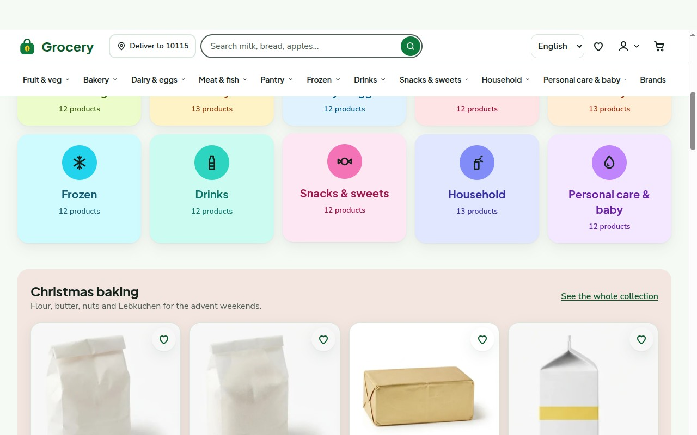
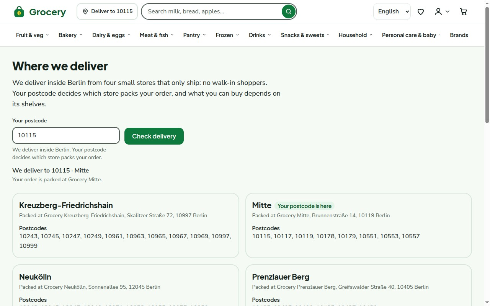
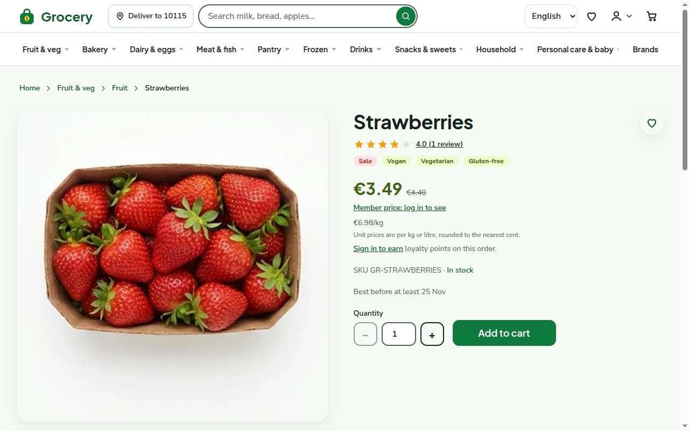
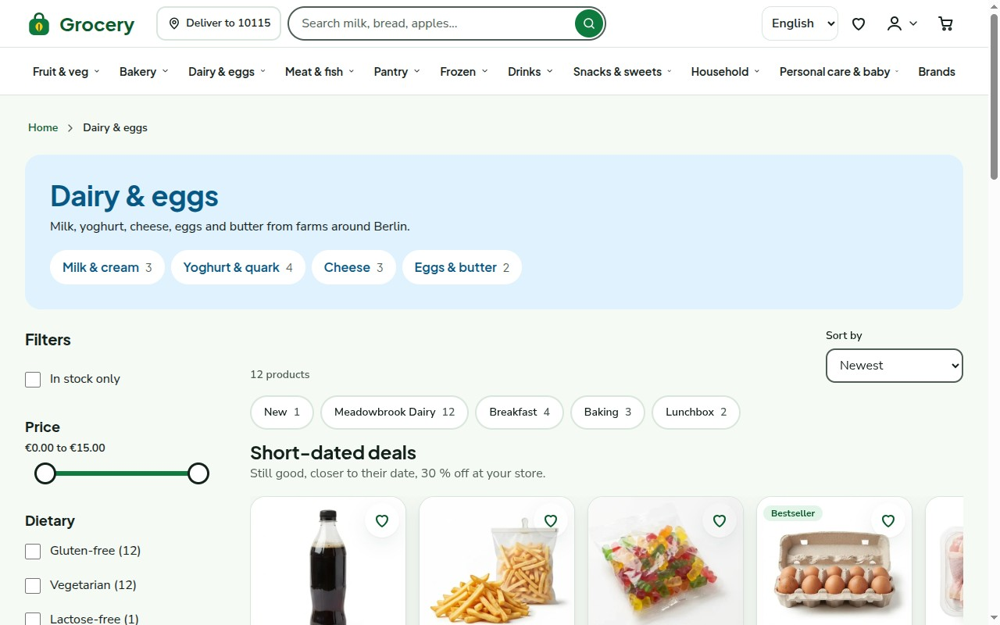
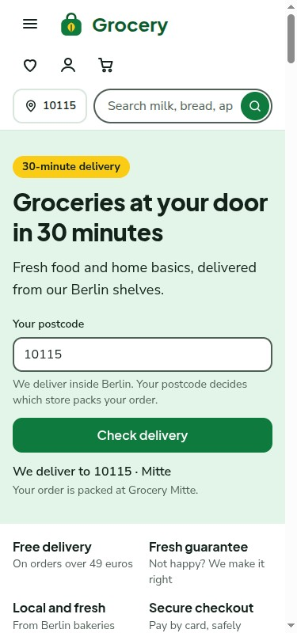
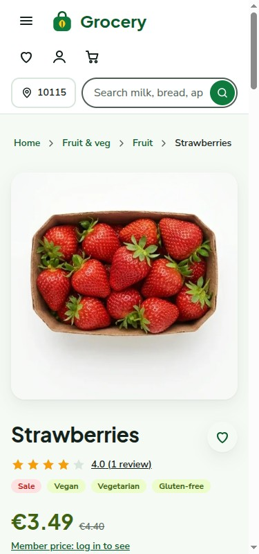
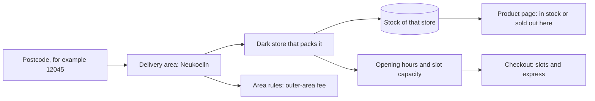
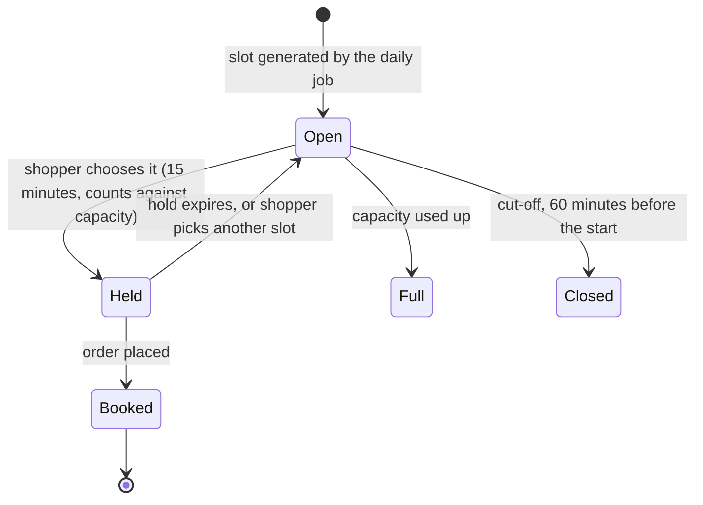
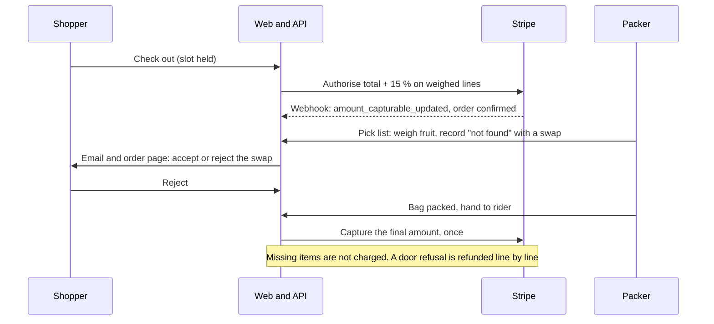
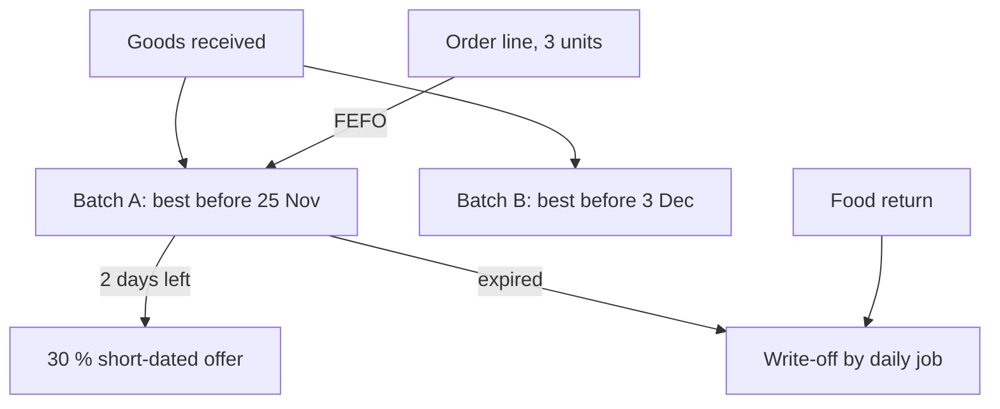

# Grocery

**Live demo: <https://grocery-store-bice-two.vercel.app>** (test mode: pay with card `4242 4242 4242 4242`,
any future date, any CVC; try postcode `10115`).

A fictional quick home-delivery shop for groceries and home basics, in the style of Getir or
Amazon Now. You enter a Berlin postcode, pick a one-hour delivery slot (or "within 30 minutes" where the
area allows it), say what to do if something is missing, and pay with Stripe in test mode. The brand,
products and shops are made up; the code, the rules and the tests are real. It is a portfolio project
that shows **the logistics of quick delivery**, built on the e-commerce engine of
[Pawsome](https://github.com/AbdelhamidYousef/pawsome-store), my earlier pet-supplies shop.

| Home | Where we deliver | A weighed product |
| --- | --- | --- |
|  |  |  |

| Department | Home on a phone | Product on a phone |
| --- | --- | --- |
|  |  |  |

## The logistics

A parcel shop answers "what is in stock?". A grocery shop must answer five harder questions, and
each one became a piece of the system.

### 1. Where can we deliver, and from which shop?

Berlin only. A postcode belongs to one **area**, an area is served by one **dark store** (a small
shop with no walk-in customers), and stock is kept **per store**, so the same product can be on the
shelf in Mitte and sold out in Neukölln. The postcode is the shopper's delivery context from the
first screen on (an `X-Postcode` header), so every price, stock level and "next delivery" is already
the right one before checkout, and checkout refuses an unserved postcode with a clear error.



### 2. When? Slots, holds and express

Each store offers one-hour slots six days ahead, each with a capacity. Choosing a slot **holds** it for
15 minutes while you pay. The hold is counted against capacity under a row lock, so two shoppers can
never take the last place, and it expires by its own `expires_at`: a late or missed clean-up job can
never over-book anything. Express ("within 30 minutes") is only offered while the store is open and
its riders are not busy.



### 3. What if it is missing? Substitutions and money

Every cart line says what to do if the store cannot find it: best alternative, a product I chose,
or refund. The card is **authorised** for the total plus a 15 % buffer on weighed lines. A packer
walks the pick list, weighs loose items and records shortfalls; a replacement is only proposed from
safe matches (same category, no new allergen, no lost dietary tag, price within 30 %), and the shopper can accept or reject it until
the bag is closed. Only then is the **final amount captured**, never above the hold.



### 4. What does it weigh? Money for loose items

Bananas are sold per kilogram. The price of a line is `price per kg x grams`, **rounded once**, and
the whole system counts money in integer cents. One shared module (`packages/shared/src/weight.ts`)
owns every weighed rule, so the product page, the cart, the authorisation and the capture cannot
disagree by a cent. A basket's fees (bags, bottle deposit, delivery by slot, the 15.00 minimum, free
delivery from 49.00 of goods) come from one pure function, `basketTotals`, used by cart, checkout,
emails and capture.

### 5. How long will it keep? Batches and first-expired-first-out

Stock is a set of **batches**, each with a best-before date. A sale takes from the batch that
expires first (FEFO). A short-dated pack is offered at 30 % off, food that comes back is written off
instead of restocked, and a daily job clears expired packs. A test invariant checks that the
batches always add up to the stock number.



## Decisions and trade-offs

The full list, with dates and the alternative that was rejected, is in
[`docs/plan/04-decisions-log.md`](docs/plan/04-decisions-log.md). The ones that shaped the system:

- **Authorise, then capture** (not charge at checkout). The shopper is charged for what is really
  packed, at the cost of a second Stripe step, a 15 % buffer and a webhook to secure the order.
- **Holds expire by themselves.** A job only deletes old rows. Costs a few extra rows; buys
  correctness on a host with no background process.
- **Stock per dark store**, not one global number. More rows and an admin editor per store, but the
  shelf the shopper sees is the shelf that packs the order.
- **One shared pricing function** wraps the existing discount engine instead of replacing it. The
  engine stays tested; cart and checkout cannot drift.
- **Jobs from GitHub Actions** every 5 minutes (Vercel runs nothing in the background). The database
  claims one run per period for each job, so one trigger serves the five-minute, hourly and daily jobs.
- **A separate free Neon project and a restricted Stripe test key** for this shop: a bad migration or a leaked
  key cannot touch the other project.
- **The simulated rider**: tracking is computed in the browser from dispatch time and the slot end,
  and the server sends only times and a first name. No real positions, no personal data on a page
  anyone with an email can open.

## Stack

React 18 and TypeScript (Vite single-page app, Tailwind CSS, TanStack Query, React Hook Form), Node 22
with Express 5, Postgres with Drizzle ORM and SQL migrations, Zod schemas shared between web and API,
Stripe (test mode only), Vitest, Testing Library, MSW and Playwright. A pnpm monorepo: `apps/web`,
`apps/api`, `packages/shared`. Deployed on Vercel (static web and one Express function on the same
origin) with Neon, GitHub Actions for the jobs ([`docs/DEPLOYMENT.md`](docs/DEPLOYMENT.md)). English and German
(du), two store views.

## What was reused from Pawsome

The engine: accounts, catalogue and search, cart and discounts, checkout with Stripe, orders, emails,
returns, loyalty, reviews, the admin and the test setup. It was copied with its history, and the
pet-specific features (gift finder, pet profiles, vet gate, size guides) were removed. New in Grocery:
areas and dark stores, slots and holds, express, batches and expiry, weighed items, manual capture,
substitutions, the packer view, tracking with a simulated rider, basket rules, usuals and shopping
lists. [Pawsome's README](https://github.com/AbdelhamidYousef/pawsome-store) covers the engine.

## Tests

Last full run: shared 338, web 1,048, API 1,665 (3 skipped), end-to-end 86 (1 skipped). The API tests run
against a real Postgres; the end-to-end suite drives the real app in Chromium, including the journey
from postcode to door (`e2e/grocery-journey.spec.ts`: a weighed item, a short-dated item, a bottle
with deposit, a slot, the card hold, a refused swap, the capture, the rider, the final bill). CI
runs all of it on every push.

## Local setup

Needs Node 22, pnpm and Docker. Run from the repository root. The ports differ from Pawsome's, so
both can run on one machine.

```sh
nvm use                      # Node 22 (.nvmrc); skip if you manage Node otherwise
corepack enable              # gives you the pinned pnpm
pnpm install
cp .env.example .env         # the defaults work as they are; Stripe keys stay empty
docker compose up -d         # Postgres on 5433, Mailpit on 8026
pnpm db:migrate
pnpm db:seed                 # prints the demo logins
pnpm dev                     # web http://localhost:5174, API http://localhost:3001
```

Check it: `curl localhost:3001/api/v1/health` answers `{"status":"ok","db":"ok",...}`. Captured
emails are at http://localhost:8026.

Checks, as CI runs them:

```sh
pnpm typecheck && pnpm lint && pnpm format:check && pnpm test
pnpm e2e                     # needs the services above and a migrated, seeded database
```

See [CONTRIBUTING.md](CONTRIBUTING.md) for the commit style and branch flow.

## Plan, journal and credits

The plan, the decisions log, the build journal (with a quiz per phase) and the handover are in
[`docs/plan`](docs/plan/00-overview.md). Image and font credits are in [CREDITS.md](CREDITS.md).

## Licence

[MIT](LICENSE).
